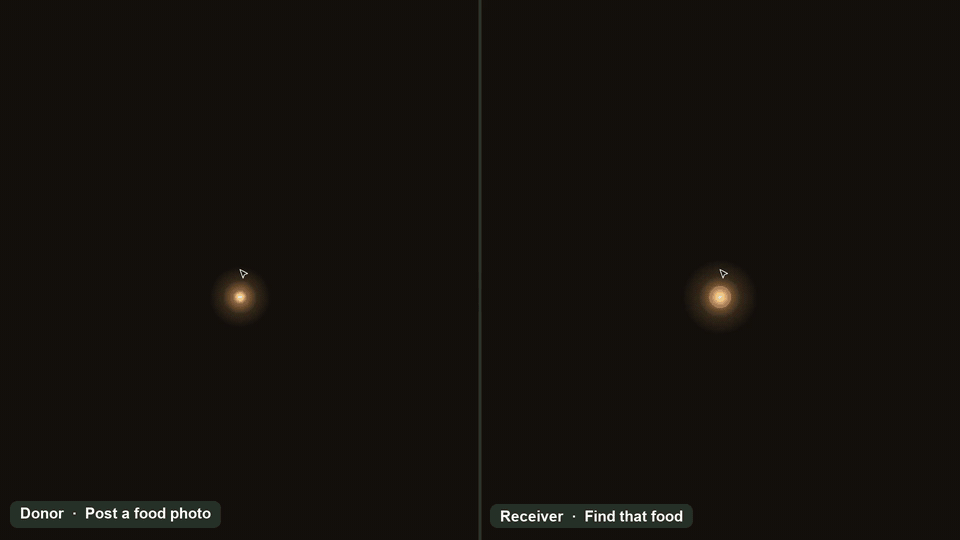

# Overflow

Food donation and redistribution app built with React, TypeScript, Vite, and Supabase, for #HACKTN26 Challenge #1 (Tennessee Food Edition).

## Demo

[](docs/demo/overflow-demo.mp4)

On the left, a donor uploads a photo of a chocolate donut. OCI Generative AI fills in the food name and quantity, the donor picks a pickup window, and posts it. On the right, a receiver sees the new listing appear in real time and finds it with search. [Watch the full-quality video (MP4, 37 s)](docs/demo/overflow-demo.mp4).

## About the project

Nashville could rescue about 9.3 million meals a year, and more than 450,000 people in Middle and West Tennessee faced food insecurity in 2025. The food exists and the need exists; the gap is access. Overflow connects restaurants that have cooked surplus with nearby people and community groups who can use it, with no purchase or other barrier in between.

- **Donors (sponsors)** snap a photo of their surplus. OCI Generative AI fills in the food name, quantity and description, and the donor picks pickup windows before the food expires.
- **Recipients** browse nearby food on a list or map, ask the AI search for what they need, and reserve a pickup slot. New listings appear in real time.
- **Looking ahead:** semantic matching against dietary needs with Oracle AI Vector Search, and recipe ideas tailored to rescued ingredients.

Team Overflow: Peter Harlan, Charles Lee, Edward He, David Fang.

Pitch deck: [Overflow on Canva](https://www.canva.com/d/3zrGzAbE0ORzY7n)

## Prerequisites

- Node.js
- npm
- Docker
- Make

## Getting started

Clone the repository and enter the project directory:

```bash
git clone <repository-url>
cd Overflow-HackTN26
```

Install dependencies, start local Supabase, seed the database, and generate the local environment and account files:

```bash
make setup
```

Start the full development stack:

```bash
make dev
```

The app is available at `http://127.0.0.1:8080/`. Run `make backend-status` to view the local Supabase URLs.

Development account credentials are stored in `dev.md`. Seed data is sourced from `supabase/seed-data.json`.

## Development flow

```bash
make install        # Install npm dependencies
make setup          # Install dependencies, start Supabase, apply migrations, and seed data
make frontend       # Run only the Vite frontend
make open           # Open the local UI in the default browser
make backend        # Start local Supabase
make backend-status # Show local Supabase service status
make seed           # Seed local users, listings, and requests
make dev-accounts   # Regenerate dev.md account documentation
make db-reset       # Reset and reseed the local database
make migrate        # Apply pending local database migrations
make typecheck      # Run the TypeScript compiler
make test           # Run the test suite
make build          # Build the production frontend
make check          # Run typecheck, lint, tests, and the production build
make dev            # Start Supabase, migrate, seed, and run configured services
make backend-stop   # Stop local Supabase
make ai-server      # Start the photo autofill API (see server/README.md)
```

`make dev` intentionally stays in the foreground while Vite runs. Stop it with Ctrl-C; this is expected and is not a seed-script hang.

Run `make help` to list every available command:

```bash
make help
```

Use `make seed` to reseed the local database or `make db-reset` to reset and reseed it. Run `make dev-accounts` to regenerate `dev.md` from `supabase/seed-data.json`.

## Environment

`make seed` generates `.env.local` for local Supabase. Use `example.env` as the variable template when configuring another environment.

## Production deployment

Configure the self-hosted Supabase Auth Site URL and redirect allow-list to the public frontend origin before release. Apply migrations to production before releasing the frontend; back up first and do not use a destructive reset command:

```bash
npx supabase db push --db-url "$SUPABASE_DB_URL"
```

Copy `.env.production.example` securely and never commit production values. Build and run the static frontend image with:

```bash
make production-build \
  VITE_SUPABASE_URL="https://supabase.example.com" \
  VITE_SUPABASE_PUBLISHABLE_KEY="your-publishable-key"
make production-run
```

Override the image and host port when needed, for example `make production-run IMAGE=overflow-web PORT=8080`. When building behind a TLS-inspecting proxy, use a direct `docker build` command to pass the BuildKit CA secret flag `--secret id=build-ca,src=/path/to/company-ca.crt`; the Make target does not support BuildKit secrets.


The health endpoint is `/healthz`. `VITE_*` values are public and baked into the frontend, so use only the publishable/anon key and never a service role key. TLS must terminate at a reverse proxy or load balancer, and browsers must be able to reach the self-hosted Supabase HTTPS URL.

## Branding

Update `APP_NAME` and `BRAND_COLOR` in `src/config/brand.ts` to rebrand the application.

## Donor photo analysis

The donor form supports camera capture or a JPEG, PNG, or WebP upload up to 5 MB. Selecting a photo runs real backend analysis, shows a description, and suggests an editable food name. OCI can also suggest a visible item count. Donors set availability themselves; photos cannot establish safe expiry, allergens, or food safety.

Photos are resized in the browser and saved to private Supabase storage when a donation is posted. The photo and analysis appear on donor and receiver listings. Authenticated receivers can view attached photos; unattached uploads remain private. If analysis fails, the form shows the error and supports retry, removing the photo, or posting with manual details.

For local Gemini analysis, create `supabase/.env.functions` (git-ignored):

```env
GEMINI_API_KEY=your-key
GEMINI_MODEL=gemini-2.5-flash
```

Then run `make dev`. It applies pending migrations, seeds the database, and starts the frontend and configured AI services together. Stop the stack with Ctrl+C. No separate function terminal is needed. Without AI credentials, manual donations still work and startup explains what is missing.

The existing OCI service remains supported: follow [server/README.md](server/README.md) to configure `.env.server`. When present, `make dev` starts it too. The browser tries OCI first, with a 45-second timeout, and falls back to Supabase Gemini. Both services perform real model inference; there is no simulated success response.

For hosted Supabase, apply migrations, set backend secrets, and deploy the function:

```sh
npx supabase db push
npx supabase secrets set GEMINI_API_KEY=your-key GEMINI_MODEL=gemini-2.5-flash
npx supabase functions deploy analyze-food --no-verify-jwt
```

The function validates the bearer token using Supabase Auth and restricts callers to donors. Gateway JWT verification is disabled to support asymmetric Supabase tokens; application authentication remains required. Never expose Gemini keys in `VITE_` variables. See [Gemini image understanding](https://ai.google.dev/gemini-api/docs/image-understanding).

To verify local database and storage behavior against seeded accounts:

```sh
node scripts/check-food-flow.mjs
# Include one live AI request (requires the local function to be running):
CHECK_AI=1 node scripts/check-food-flow.mjs
```

This check creates and cleans up a temporary listing/photo, checks stored analysis and receiver access, and verifies that receivers cannot read unattached photos.

### Image metadata

New donor photos retain original filename, MIME type, byte size, and decoded dimensions alongside the resized JPEG's format, size, and dimensions. These details remain stored in the background and are not shown in the donation UI. The database records when the photo is attached to a listing; editing other fields preserves that timestamp. Original metadata is captured in the browser before JPEG conversion and is descriptive, not proof of when or where a photo was taken. This feature does not extract EXIF camera or GPS data. Older listings remain supported and show no invented metadata or upload times.

### Analyzer keywords and LLM handoff

OCI and Gemini now generate up to 15 keywords describing visible food, preparation, and packaging. Keywords are normalized and deduplicated, with visible items or the detected title used for older model responses. Non-food results produce no food query.

Each new `food_analysis` includes `keywords` and `llm_query`. The latter is a versioned JSON payload with `schema_version`, `task`, and `messages` (a system instruction plus a JSON observation message containing keywords, title, description, and source model). Use `analysis.llm_query.messages` as the messages for a downstream LLM, adding your own task-specific requirements in trusted instructions. Model observations remain untrusted input. The payload does not include GPS, account details, filenames, or inferred safety/expiry.

The donor form and saved listings show keyword tags. The LLM query payload is stored in the background and is not exposed in the UI. This prepares a handoff; it does not invoke a second LLM automatically. Existing listings are unchanged until reanalyzed. No database migration is required because the payload is stored in the existing analysis JSON. Restart the OCI server or redeploy/restart the Supabase function to use the updated keyword prompts.
